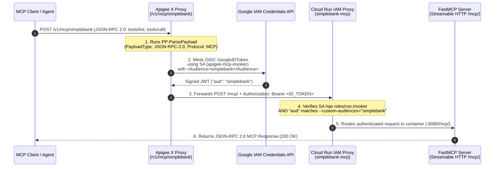

# Securing a Cloud Run MCP Server with Custom Audiences & Apigee X (`aft`)

End-to-end reference implementation for deploying a private **Model Context Protocol (MCP)** Server (Streamable HTTP) on **Google Cloud Run**, secured via **IAM + Custom OIDC Audience (`simplebank`)**, and exposed through **Apigee X** with the native **`ParsePayload` (JSON-RPC 2.0 / MCP)** policy and **Apigee Feature Templater (`aft`)**.

Designed to run out-of-the-box in **any Google Cloud environment (Standard GCP or Argolis)** assuming a **zero-state Cloud Run setup** (where Cloud Run / Cloud Build / Artifact Registry APIs are not yet enabled, while Apigee X is already provisioned).

---

## Architecture Overview



---

## Repository Structure

| File | Description |
| :--- | :--- |
| `env.sh` | Central configuration script. Auto-detects active `PROJECT_ID`, Apigee environment (`APIGEE_ENV`), and Apigee Environment Group hostname (`APIGEE_HOST`). |
| `main.py` | Stateless **Streamable HTTP** MCP Server built with Python `FastMCP`, exposing 3 mock banking tools: `get_account_balance`, `list_transactions`, and `transfer_funds`. |
| `requirements.txt` | Pinned Python dependencies (`mcp==1.9.4`, `pydantic==2.10.6`, `uvicorn==0.34.0`, `starlette==0.45.3`). |
| `Dockerfile` | Lightweight `python:3.11-slim` container listening on port `8080`. |
| `mcp-simplebank.template.yaml` | **Apigee Feature Templater (`aft`)** proxy definition including the `PP-ParsePayload` policy (`JSON-RPC-2.0` / `MCP`), streaming properties, and `<GoogleIDToken><Audience>__CUSTOM_AUDIENCE__</Audience></GoogleIDToken>`. |
| `mcp-simplebank-product.yaml` | **Apigee Feature Templater (`aft`)** API Product definition with MCP `payloadOperations` (`tools/list`, `tools/call`). |
| `01-deploy-cloudrun.sh` | **Stage 1 Script:** Enables Cloud Run/Build/IAM APIs from scratch, configures IAM for both Standard GCP & Argolis, deploys the private Cloud Run service, registers the custom audience (`simplebank`), and binds the Apigee invoker Service Account. |
| `02-deploy-apigee.sh` | **Stage 2 Script:** Queries the deployed Cloud Run URL dynamically, renders `mcp-simplebank.yaml`, downloads `aft` automatically if not installed, and deploys the Proxy + MCP Product to Apigee X. |
| `03-test-mcp.sh` | **Stage 3 Script:** Runs end-to-end JSON-RPC 2.0 `tools/list` and `tools/call` (`get_account_balance`) requests through the Apigee X endpoint. |

---

## Prerequisites & Assumptions

1. **Apigee X Provisioned:** An Apigee X organization, at least one environment (e.g., `dev` or `eval`), and an external or internal Environment Group hostname are already provisioned in your GCP project.
2. **Zero-State Cloud Run:** You do **not** need Cloud Run, Cloud Build, Artifact Registry, or IAM Credentials APIs enabled beforehand—`01-deploy-cloudrun.sh` enables them and configures all required default Service Account permissions automatically.
3. **Tools Required:** `gcloud` CLI, `curl`, and `bash` (runs directly in **Google Cloud Shell**, Linux, or macOS).

---

## Step-by-Step Deployment Guide

### Step 0: Clone the Repository & Review `env.sh`

```bash
git clone https://github.com/<YOUR_GITHUB_USER>/apigee-cloudrun-mcp-custom-audience.git
cd apigee-cloudrun-mcp-custom-audience
chmod +x *.sh
```

By default, `env.sh` automatically detects your active `gcloud` project (`PROJECT_ID`), your Apigee environment (`APIGEE_ENV`), and your Apigee hostname (`APIGEE_HOST`). You can override any variable before running the scripts:

```bash
# Optional overrides (otherwise auto-detected by env.sh):
export PROJECT_ID="your-gcp-project-id"
export REGION="europe-west2"
export CUSTOM_AUDIENCE="simplebank"
```

---

### Stage 1: Deploy Private Cloud Run MCP Server with Custom Audience

Run `./01-deploy-cloudrun.sh`:

```bash
./01-deploy-cloudrun.sh
```

**What this script does:**
1. **Enables APIs from scratch:** `run.googleapis.com`, `cloudbuild.googleapis.com`, `artifactregistry.googleapis.com`, `iam.googleapis.com`, `iamcredentials.googleapis.com`, and `apigee.googleapis.com`.
2. **Configures Argolis / Fresh Project IAM:** Grants `roles/run.admin`, `roles/cloudbuild.builds.editor`, `roles/apigee.admin`, and `roles/iam.serviceAccountAdmin` to your active user, and grants `roles/storage.admin`, `roles/artifactregistry.writer`, and `roles/logging.logWriter` to the default Compute Engine Service Account so `gcloud run deploy --source .` succeeds on brand-new projects.
3. **Deploys Private Cloud Run Service:** Builds and deploys `simplebank-mcp` with `--no-allow-unauthenticated`.
4. **Registers the Custom Audience:** Updates the Cloud Run service with `--add-custom-audiences="simplebank"`, allowing Cloud Run to accept Google OIDC ID Tokens containing `"aud": "simplebank"`.
5. **Configures Apigee Southbound IAM:**
   - Creates `apigee-mcp-invoker@<PROJECT_ID>.iam.gserviceaccount.com`.
   - Grants `roles/run.invoker` on `simplebank-mcp` to `apigee-mcp-invoker`.
   - Grants `roles/iam.serviceAccountTokenCreator` on `apigee-mcp-invoker` to the Apigee Service Agent (`service-<PROJECT_NUMBER>@gcp-sa-apigee.iam.gserviceaccount.com`) so Apigee X can mint Google ID Tokens at runtime.

---

### Stage 2: Deploy Apigee X Proxy (`ParsePayload` + `GoogleIDToken`) & MCP Product

Run `./02-deploy-apigee.sh`:

```bash
./02-deploy-apigee.sh
```

**What this script does:**
1. **Fetches Cloud Run URL dynamically:** Queries `gcloud run services describe simplebank-mcp --format="value(status.url)"`.
2. **Generates `mcp-simplebank.yaml`:** Replaces `__CLOUD_RUN_URL__` and `__CUSTOM_AUDIENCE__` (`simplebank`) in `mcp-simplebank.template.yaml`.
   > **Note on Trailing Slash (`/mcp/`):** FastMCP mounts the Streamable HTTP ASGI application at `/mcp/`. Setting the Apigee Target `<URL>` to `${CLOUD_RUN_URL}/mcp/` avoids a `307 Temporary Redirect` from Starlette.
3. **Deploys with Apigee Feature Templater (`aft`):** Downloads the standalone `aft` binary (if not already in `PATH`), deploys `mcp-simplebank-v1` bound to `apigee-mcp-invoker@<PROJECT_ID>.iam.gserviceaccount.com`, and creates the `mcp-simplebank-product` API Product.

---

### Stage 3: Test the MCP Server End-to-End through Apigee X

Run `./03-test-mcp.sh`:

```bash
./03-test-mcp.sh
```

**Expected Output:**
1. **`tools/list` Response:**
   ```json
   {
     "jsonrpc": "2.0",
     "id": 1,
     "result": {
       "tools": [
         {
           "name": "get_account_balance",
           "description": "Retrieve the available balance for a bank account (e.g., ACC-001, ACC-002).",
           "inputSchema": {
             "properties": { "account_id": { "title": "Account Id", "type": "string" } },
             "required": ["account_id"],
             "title": "get_account_balanceArguments",
             "type": "object"
           }
         },
         {
           "name": "list_transactions",
           "description": "List the most recent transactions for a bank account.",
           "inputSchema": { ... }
         },
         {
           "name": "transfer_funds",
           "description": "Transfer funds between two bank accounts.",
           "inputSchema": { ... }
         }
       ]
     }
   }
   ```
2. **`tools/call` (`get_account_balance` for `ACC-001`) Response:**
   ```json
   {
     "jsonrpc": "2.0",
     "id": 2,
     "result": {
       "content": [
         {
           "type": "text",
           "text": "{\n  \"account_id\": \"ACC-001\",\n  \"holder\": \"Alice Johnson\",\n  \"balance\": 15400.5,\n  \"currency\": \"USD\"\n}"
         }
       ],
       "isError": false
     }
   }
   ```

---

## Verifying Custom Audience Enforcement (Negative Test)

To verify that Cloud Run strictly enforces the custom audience (`simplebank`), you can deploy the Apigee proxy with an unregistered audience (`wrong-audience`) and test it:

```bash
# 1. Deploy proxy with a mismatched audience
CUSTOM_AUDIENCE="wrong-audience" ./02-deploy-apigee.sh

# 2. Wait ~15 seconds for Apigee X revision synchronization, then test:
sleep 15
source ./env.sh
curl -ks -i -X POST "https://${APIGEE_HOST}/v1/mcp/simplebank" \
  -H "Content-Type: application/json" \
  -H "Accept: application/json, text/event-stream" \
  -d '{"jsonrpc":"2.0","id":1,"method":"tools/list","params":{}}'
```

Cloud Run immediately rejects the token minted by Apigee X with **`HTTP/2 401 Unauthorized`**:
```http
HTTP/2 401 
www-authenticate: Bearer error="invalid_token" error_description="The access token could not be verified"
content-type: text/html; charset=UTF-8

<h1>Error: Unauthorized</h1>
<h2>Your client does not have permission to the requested URL <code>/mcp/</code>.</h2>
```

Restore the valid audience (`simplebank`):
```bash
CUSTOM_AUDIENCE="simplebank" ./02-deploy-apigee.sh
```
